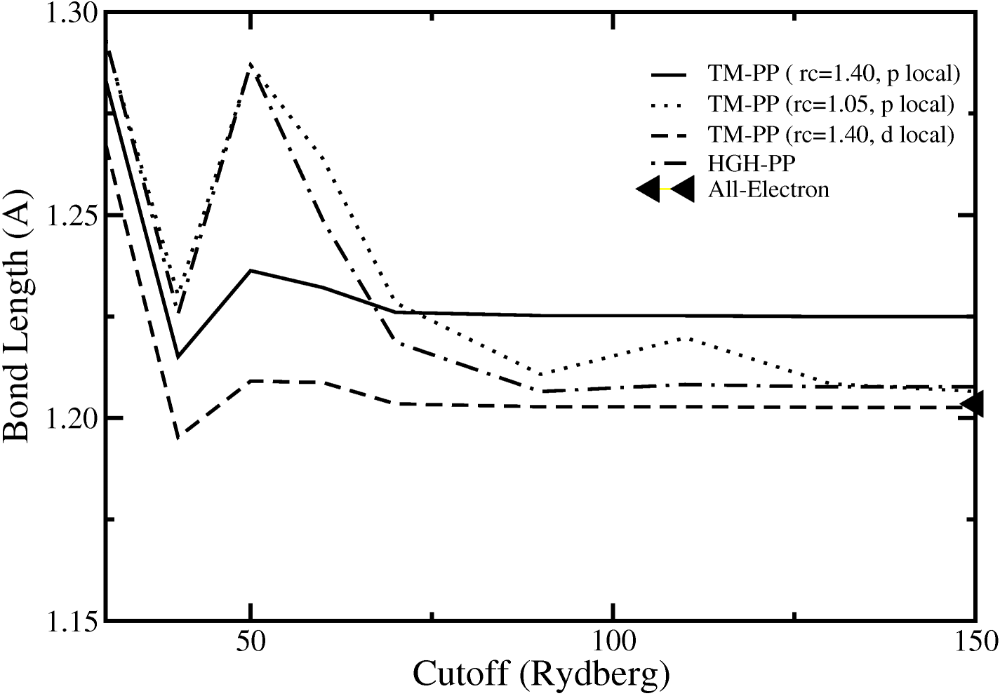

.. _hints:cutoff:

Pseudopotentials and Plane Wave Cutoff
======================================

The selection of proper pseudopotentials and the corresponding plane wave
cutoff are crucial for obtaining good results with a CPMD calculation. The
cutoff required is mainly determined by the type and the “softness” of a
pseudopotential.

Ideally a pseudopotential for a specific atom type should be usable for all
kinds of calculations (Transferability), but in practice one frequently has to
make compromises between accuracy and impact on the computational effort when
creating a pseudopotential. Therefore one always has to test pseudopotentials
before using them on new systems. There are quite a large number of CPMD
calculations published (see http://www.cpmd.org/cpmd_publications.html) which
can serve as a guideline.

Since CPMD uses a plane wave basis, a concept of several different, formalized
basis sets of different quality, like with gaussian basis set based quantum
chemical software, does not apply here. Since plane waves are ’delocalized’ in
space, they provide the same ’quality’ everywhere in space and one can increase
the basis set almost arbitrarily by increasing the number of plane waves via
the :kw:`CUTOFF` keyword. The cutoff has to be chosen in such a way,
that all required quantities are reasonably converged with respect to the plane
wave cutoff. For a molecular dynamics run this refers primarily to the atomic
forces. For the calculation of other properties like the stress tensor a
different, usually a much higher cutoff is required. It’s always a good idea to
make checks at some critical points of the calculations by increasing the
cutoff.

   Convergence of the bond length of the O\ :sub:`2` molecule with the plane
   wave cutoff for Troullier-Martins pseudopotentials (TM-PP) with different
   core radii and local channels, and for a Goedecker (HGH) pseudopotential,
   compared with the all-electron value.

Typical cutoff values range from 20–40 ry for Vanderbilt ultra-soft
pseudopotentials, 60–100 ry for Troullier-Martins norm-conserving
pseudopotentials to 80–200 ry for Goedecker pseudopotentials. Pseudopotentials
of different types can be freely mixed, but the required plane wave cutoff is
determined by the “hardest” pseudopotential. Support for Vanderbilt ultra-soft
pseudopotentials is (mostly) limited to the basic functionality like molecular
dynamics and geometry optimization.
